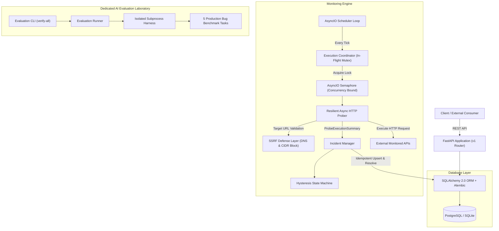

# SignalGuard

[](https://github.com/SignalGuard/SignalGuard/actions)
[](https://www.python.org/)
[](https://fastapi.tiangolo.com/)
[](https://www.sqlalchemy.org/)
[](LICENSE)
[](https://github.com/astral-sh/ruff)

**SignalGuard** is a production-grade backend reliability and API observability platform with a dedicated **AI software testing and code-verification laboratory**.

It is engineered with a dual mission:
1. **Production Reliability Platform:** Autonomously monitors remote HTTP/S APIs, enforces SSRF and DNS rebinding protections, eliminates flapping alert storms via hysteresis, bounds async probe concurrency, and guarantees single-active-incident deduplication.
2. **AI Code-Evaluation Laboratory:** Contains self-contained, realistic backend engineering benchmarks, buggy starters, reference solutions, and deterministic test verifiers designed to evaluate AI coding agents and senior backend engineering candidates.

---

## Architecture Overview



---

## Key Platform Features

### 1. Reliable API Monitoring Engine
- **Autonomous Polling:** Configurable polling intervals (minimum 5s) and request timeouts.
- **Controlled Concurrency:** Bounded via `asyncio.Semaphore` (prevents socket exhaustion and CPU starvation).
- **Check Stampede Prevention:** Per-endpoint in-flight execution locks skip/defer scheduled checks if an earlier check is still running.
- **Resilient Probing:** Bounded exponential backoff with full jitter for transient 5xx server errors; immediate fail without retries for deterministic 4xx client errors.
- **Memory Protection:** Max response snippet truncation (16 KB) prevents out-of-memory crashes on large streaming responses.

### 2. Concurrency-Safe Incident Management
- **Single-Active-Incident Invariant:** Guarantees at most ONE open incident per endpoint under concurrent probe failures.
- **Flapping Suppression & Hysteresis:** Requires 2 consecutive failures to mark a service `DOWN` (prevents false positives from transient packet loss) and 2 consecutive successes to mark `HEALTHY`.
- **Automated Lifecycle:** Automatically resolves active incidents when target endpoints recover, maintaining a complete timestamped event audit trail.

### 3. Hardened Security & SSRF Protection
- **Scheme Enforcement:** Allows only `http` and `https`.
- **IP Range Blocklists:** Blocks loopback (`127.0.0.0/8`, `::1`), RFC 1918 private subnets (`10.0.0.0/8`, `172.16.0.0/12`, `192.168.0.0/16`), link-local and cloud metadata addresses (`169.254.0.0/16`, `169.254.169.254`), and IPv6 ULA (`fc00::/7`).
- **Obfuscated IP Evasion Defense:** Normalizes and detects decimal integers (`2130706433`), hex (`0x7f000001`), octal (`0177.0.0.1`), and IPv4-mapped IPv6 (`::ffff:127.0.0.1`).
- **DNS Rebinding & Redirect Defense:** Resolves all hostnames prior to connection and checks every resolved address; disables automatic redirects.

---

## AI Code Evaluation & Verifier Laboratory

Located in `evaluation/`, this suite evaluates whether an AI coding agent or candidate can diagnose complex backend bugs, design defensible fixes, and satisfy rigorous behavioral verifiers.

### Benchmark Tasks

| Task ID | Domain | Challenge | Root Cause & Real-World Impact |
|---|---|---|---|
| **`task_01_ssrf_protection`** | Security | SSRF Evasion | Naive string matching bypassed by octal/hex IPs, leaking cloud metadata (`169.254.169.254`). |
| **`task_02_concurrent_incidents`** | Concurrency | Race Condition | Check-then-act creates duplicate active incidents when multiple checks fail simultaneously. |
| **`task_03_timeout_retry_backoff`** | Reliability | Retry Storm | Retries 4xx client errors and lacks jitter, creating thundering herds under network degradation. |
| **`task_04_overlapping_check_lock`** | AsyncIO | Check Stampede | Slow probes accumulate overlapping tasks on subsequent ticks, exhausting socket descriptors. |
| **`task_05_state_machine_flapping`** | State Machine | Alert Oscillation | Zero-hysteresis toggles state on single dropped packets, flooding on-call channels. |

### Running the Verifier CLI

```bash
# Verify the entire evaluation benchmark matrix:
python -m evaluation.cli verify-all

# Verify an individual task with human-readable summary:
python -m evaluation.cli verify task_01_ssrf_protection --target solution

# Output machine-readable JSON for automated benchmark grading:
python -m evaluation.cli verify-all --json
```

**Benchmark Result Matrix:**
```text
================ SignalGuard Evaluation Laboratory Matrix ================
Task ID                             Starter (Buggy)      Solution (Fix)     Verified?
-------------------------------------------------------------------------------------
task_01_ssrf_protection             [FAIL] (Expected)    [PASS] (Expected)  [VERIFIED]
task_02_concurrent_incidents        [FAIL] (Expected)    [PASS] (Expected)  [VERIFIED]
task_03_timeout_retry_backoff       [FAIL] (Expected)    [PASS] (Expected)  [VERIFIED]
task_04_overlapping_check_lock      [FAIL] (Expected)    [PASS] (Expected)  [VERIFIED]
task_05_state_machine_flapping      [FAIL] (Expected)    [PASS] (Expected)  [VERIFIED]
=====================================================================================
All evaluation tasks verified successfully! Deterministic benchmarks confirmed.
```

---

## Quickstart

### Prerequisites
- Python 3.12+ (or Docker & Docker Compose)

### 1. Local Setup
```bash
# Clone repository
git clone https://github.com/SignalGuard/SignalGuard.git
cd SignalGuard

# Create and activate virtual environment
python -m venv .venv
source .venv/bin/activate  # On Windows: .\.venv\Scripts\Activate.ps1

# Install dependencies
pip install -r requirements.txt

# Run database migrations
alembic -c backend/alembic.ini upgrade head

# Start FastAPI server
uvicorn backend.app.main:app --reload --port 8000
```
Interactive API documentation will be available at [http://localhost:8000/docs](http://localhost:8000/docs).

### 2. Docker Compose Setup
```bash
docker compose up -d --build
```
This spins up PostgreSQL 16 and the SignalGuard FastAPI application with automated healthchecks.

---

## API Quickstart

### Register a New Endpoint
```bash
curl -X POST http://localhost:8000/api/v1/endpoints \
  -H "Content-Type: application/json" \
  -d '{
    "name": "GitHub Status API",
    "url": "https://api.github.com/status",
    "method": "GET",
    "interval_seconds": 30,
    "timeout_seconds": 5,
    "expected_status": 200,
    "retry_count": 3
  }'
```

### Trigger On-Demand Check
```bash
curl -X POST http://localhost:8000/api/v1/endpoints/1/check
```

### Query Endpoint SLA & Latency Metrics
```bash
curl -X GET http://localhost:8000/api/v1/endpoints/1/metrics
```

### Inspect Active Incidents
```bash
curl -X GET http://localhost:8000/api/v1/incidents?status=OPEN
```

---

## Automated Testing & Quality Engineering

SignalGuard enforces a 100% deterministic test suite across unit, integration, concurrency, and security regression domains:

```bash
# Run complete test suite with coverage report:
pytest -v --cov=backend/app --cov-report=term-missing

# Run static analysis and lint checks:
ruff check backend evaluation tests
```

### Test Suite Structure
- `tests/unit/`: Configuration, state machine transitions, retry delay calculations, model relationships, and redacting logger.
- `tests/integration/`: FastAPI REST endpoints, database transactions, on-demand probing, and history pagination.
- `tests/concurrency/`: In-flight overlap locking, semaphore bounds, and concurrent incident deduplication.
- `tests/security/`: SSRF attack simulations (decimal, octal, hex, IPv6-mapped, link-local metadata, userinfo spoofing).

---

## Architecture Decision Records (ADRs)

- [ADR 0001: AsyncIO Prober Concurrency & Semaphore Bounds](docs/adr/0001-async-prober-concurrency.md)
- [ADR 0002: Comprehensive SSRF Mitigation & DNS Verification](docs/adr/0002-ssrf-mitigation-strategy.md)
- [ADR 0003: Incident Deduplication Invariants & State Hysteresis](docs/adr/0003-incident-deduplication-invariants.md)

---

## License

MIT License. See [LICENSE](LICENSE) for details.
