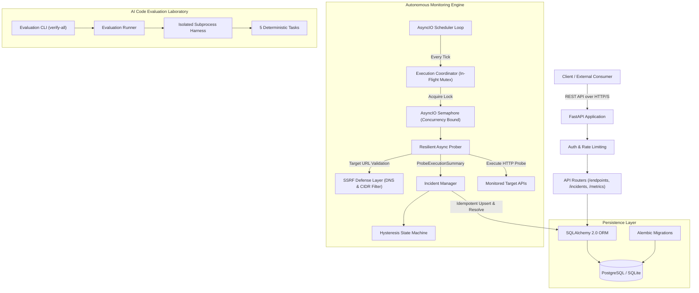
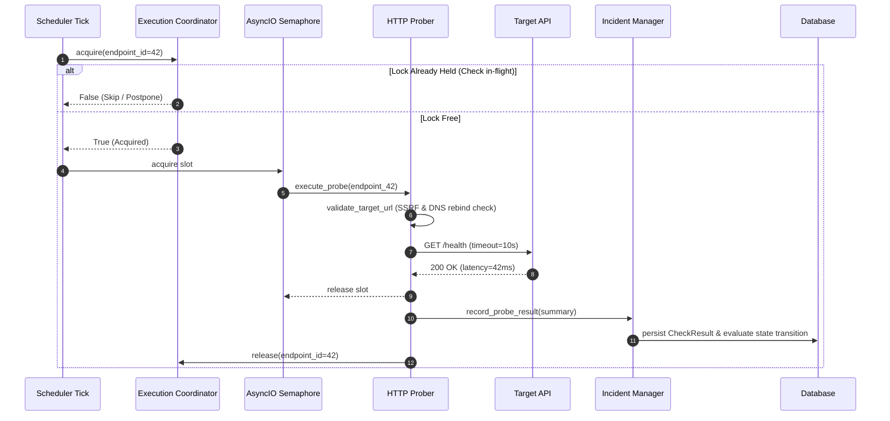
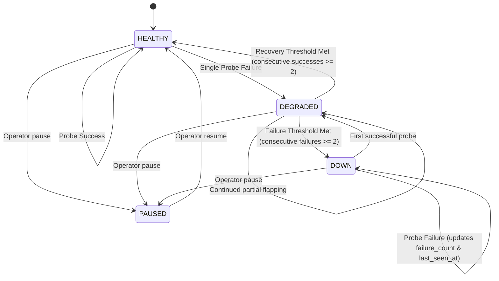
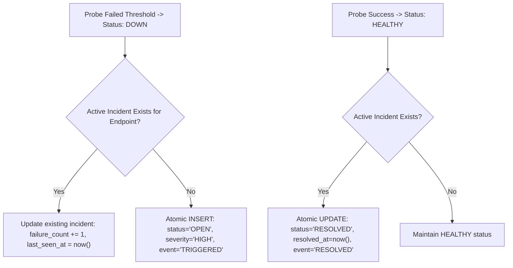

# SignalGuard — System Architecture & Engineering Design

SignalGuard is an enterprise-grade backend reliability observability platform coupled with a deterministic software verification laboratory.

---

## 1. High-Level Component Topology

---

## 2. Asynchronous Prober Execution & Overlap Prevention

When target response times exceed polling intervals ($T_{\text{latency}} > T_{\text{interval}}$), naive schedulers spawn accumulating concurrent probe tasks against struggling services (**check stampedes**).

SignalGuard prevents this via a per-endpoint in-flight execution lock:

---

## 3. Finite State Machine with Hysteresis (Flapping Suppression)

To eliminate alert fatigue caused by single transient packet drops, the state machine requires multi-sample confirmation:
- **HEALTHY $\rightarrow$ DOWN:** requires $N$ consecutive failures (default 2 or 3). An initial failure moves the state to intermediate **DEGRADED**.
- **DOWN $\rightarrow$ HEALTHY:** requires $M$ consecutive successes (default 2).

---

## 4. Single-Active-Incident Invariant

SignalGuard guarantees that for any endpoint $E$, there is at most **one active incident** ($\text{status} \in \{\text{OPEN}, \text{ACKNOWLEDGED}\}$) at any point in time:

